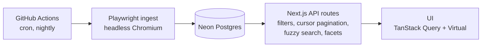

# DIBBS Opportunities

A production-shaped vendor view of open DLA DIBBS RFQs (government solicitations for
distributors and manufacturers) — reliable ingest, a real Postgres-backed API, and a fast,
filterable table, instead of the original take-home's client-side JSON pass-through.

**Live:** _TBD — not yet deployed to Vercel._
**Original interview submission:** [`v1-interview-submission`](../../tree/v1-interview-submission) ·
[diff against this version](../../compare/v1-interview-submission...main)

## What it does (vendor perspective)

- Opens to the **latest posting day** by default, with an "All open" toggle to see everything
  still open regardless of when it was posted.
- **Search** that's typo-tolerant on nomenclature (Postgres trigram similarity) and does exact
  prefix matching when the query looks like an NSN.
- Filters: FSC, set-aside type, min quantity, "closing within N days," Fast Award, has tech
  docs — each with live counts.
- **Flags**: new-in-24h, Fast Award, First Article Test.
- **First Article Test nesting**: a FAT line item (no real NSN) renders indented directly
  under its parent real-NSN row, instead of as an unrelated orphan row.
- **Tech docs**: just says "On DIBBS" when present — never fetches or displays the documents
  themselves (per project rule; DIBBS requires its own login for those).
- Sortable columns (deadline, quantity, issued date, FSC, NSN), each a real indexed sort, not
  a client-side re-sort of one page.
- Infinite scroll via cursor pagination — no page numbers, no re-fetching rows you've already
  seen.

## Architecture



## Key decisions

- **Playwright over replaying the HTTP postback** — the original curl-based fetcher hand-built
  ASP.NET's `Page$N` `__doPostBack`, which silently stalled on page 1 instead of advancing. An
  exhaustive bisection (headers, cookies, body field order, URL encoding — see
  [`scripts/fetchers/curl.ts`](scripts/fetchers/curl.ts)) found no HTTP-level fix, so ingest now
  drives a real headless Chromium through the site's own pagination JS instead.
- **Idempotent upsert on a generated `row_key`** (solicitation number + NSN + PR#, see
  [`lib/parseRfqGrid.ts`](lib/parseRfqGrid.ts)'s `rowKey`) — re-ingesting the same day is always
  safe; a row updates in place rather than duplicating.
- **Keyset (cursor) pagination, not `OFFSET`** — measured head-to-head on `sort=quantity&dir=desc`
  (`open_solicitations`, ~14k rows; `EXPLAIN ANALYZE`, 3 runs each, median shown; full queries,
  runs, and query-plan detail in
  [`docs/engineering-notes.md`](docs/engineering-notes.md#keyset-vs-offset-pagination-measured-head-to-head-2026-11-23)):

  | Depth | `OFFSET` | keyset cursor |
  |---|---|---|
  | page 40 (~2,000 rows in) | 2.12ms | 1.38ms |
  | page 200 (~10,000 rows in) | 12.84ms | 5.79ms |

  The gap isn't "the keyset query skips the rows ahead of the cursor" — on this nullable
  column the cursor condition (`quantity IS NULL OR (quantity, id) < (cursor)`) can't be
  pushed down as a true index seek, so the keyset plan still walks forward examining roughly
  as many rows as `OFFSET` would skip (confirmed in the plans: similar `Rows Removed by
  Filter` counts at each depth). The real win is that `OFFSET`'s plan, once deep enough,
  switches to a sequential scan plus an explicit `Sort` of every matching row before taking
  the top 51 (at page 200: a ~12ms sort dominates the ~12.84ms total) — the keyset query
  never needs that sort because it reads an already-ordered index, so its cost grows with
  depth but stays below a full sort of the matching set.
- **`pg_trgm` over embeddings** for fuzzy search — nomenclature text is short and vocabulary-
  limited (NSN catalog terms), so trigram similarity gets typo tolerance without a vector
  pipeline, an embedding model, or any new infra.
- **A composite `(column, id)` index per sortable column**, with an explicit `DESC NULLS LAST`
  variant for descending sorts (migrations [004](db/migrations/004_sort_keyset_indexes.sql),
  [007](db/migrations/007_desc_nulls_last_indexes.sql)) — reading an ascending index backwards
  gives `DESC NULLS FIRST`, which silently puts every null-valued row first instead of last.
- **Facets computed server-side**, each dropdown's counts excluding only its own filter (the
  standard "if I also picked this, how many rows" rule), so counts can never disagree with
  what clicking the option would return.
- **Zod validation on every query param** — a malformed filter is a 400, never a silent
  wrong-query guess.
- **Relative date labels computed client-side at render time**, never stored or cached — "today
  / in N days / past due" is a function of the viewer's clock, not ingest's.
- **Default view is `posted=latest`** (today's posting date, by `MAX(source_date)`, not
  wall-clock "today") rather than "all open" — a vendor's first question is "what's new," and
  defaulting to everything open buries that under weeks of older listings.
- **No caching layer yet** — not needed: the indexed queries above already return in
  low-single-digit milliseconds. The design for scale, when it is needed: tag cache entries by
  `(filters, sort, cursor)` and invalidate the whole tag set on every ingest write (not a TTL,
  since staleness should track ingest, not a clock); include the ET posting date in the cache
  key so "latest" doesn't serve yesterday's answer after midnight; set `Cache-Control`
  (`s-maxage`, `stale-while-revalidate`) on read-only facet/browse responses so a CDN can absorb
  most of the read traffic in front of Postgres entirely.

## Correctness

CLAUDE.md's rule for this project is "never invent values" — every fix below exists because a
silent parsing or paging failure would otherwise have *dropped or miscounted real rows* without
any visible error:

- **Reconciliation against `Records Found`** — every ingest run compares rows actually parsed
  against the grid's own reported count and records a `partial` status (not a silent success)
  on any mismatch.
- **Pagination stall guard** — if two consecutive pages come back byte-identical, ingest stops
  and reports an error instead of fabricating duplicate rows (see
  [`scripts/fetchers/playwright.ts`](scripts/fetchers/playwright.ts)).
- **Run-drift detection and debug HTML dumps** — an unexpected page shape is saved to
  `data/debug/` for inspection, not swallowed.
- **Regression tests** ([`tests/parseRfqGrid.test.ts`](tests/parseRfqGrid.test.ts), 6 tests)
  built from real captured HTML, each pinned to an actual bug found in production data:
  - A `<br>--»Attachments` marker inside the solicitation-number anchor broke the capture
    regex, silently dropping rows (2 of 4,399 on 11-20).
  - `status` wrapped in a nested `<strong>` ("Removed") fell back to `''` (26 of 4,431 rows).
  - `iconCFolder` (the Tech Docs folder icon, from an unrelated cell) was counted as a
    procurement badge.
  - `iconSb.gif` ("Small Business Set-Aside," the most common set-aside icon) never matched its
    regex — `\bSb\b` has no word boundary inside one unbroken token — silently falling through
    to "other" on every row that had it.
  - A non-NSN "First Article" reference number with no catalog link silently dropped its whole
    row (32 of 34 on 11-21) before the link wrapper was made optional.
  - `open_solicitations`'s `SELECT *` view froze its column list at creation; `has_attachments`
    was invisible to every API route until the view was explicitly re-issued (migration 005).
  - `postgres.js` returns `bigint` columns (`id`) as strings to avoid precision loss — cursor
    encoding has to convert explicitly rather than assume a JS number.

## Scale: what breaks first at 100x

- **Query plans**: the composite `(column, id)` indexes already used for sorting also need to
  carry the common filter columns (`status`, `fsc`, `setAside`) so a filtered sort doesn't fall
  back to a sequential scan once the table is 100x larger — would need partial or covering
  indexes per common filter combination.
- **No caching layer**: at today's size, uncached queries are fast enough; at 100x, the cache
  design described above (tag invalidation on ingest, ET date in key, CDN headers) stops being
  optional.
- **Serial, one-date-at-a-time ingest**: a 90-minute Action timeout is comfortable for a 7-day
  rolling window today; at 100x the per-day page count, ingest would need to fan out per date
  (parallel Playwright contexts) rather than looping sequentially.
- **`word_similarity` fuzzy search** scans the whole filtered set at this size; a much larger
  catalog would need either a dedicated search engine (e.g. Postgres full-text + `pg_trgm`
  hybrid, or an external index) or precomputed/approximate matching instead of exact per-query
  trigram scoring.
- **Estimated vs. exact counts**: facet/total counts are `COUNT(*)` today; at 100x, an
  approximate count (`reltuples`-based estimate, refreshed periodically) would avoid a full
  count on every request.

## How I built this

Built under CLAUDE.md's process rules: explain the concept and real alternatives before
writing code, plan each slice (files, schema, assumptions) and get it approved, build exactly
one slice at a time, verify against real scraped data (not fixtures invented to pass), and
record what was *not* handled rather than letting scope quietly grow. Concretely: every
non-trivial design choice above (Playwright vs. HTTP replay, keyset vs. offset pagination,
`pg_trgm` vs. embeddings) went through that explain-alternatives-first step before any code was
written, and ingest was never run full-scale without asking first. See
[`CLAUDE.md`](CLAUDE.md) for the exact rules and [`docs/engineering-notes.md`](docs/engineering-notes.md)
for investigation notes that didn't fit here (e.g. why a DIBBS flat-file export was considered
and rejected).

## Run locally

```bash
# .env.local: DATABASE_URL=..., DATABASE_URL_DIRECT=... (a Neon Postgres project)
npm install
npx playwright install chromium    # one-time: downloads the browser ingest uses

npm run migrate                    # applies db/migrations/*.sql, no-op if already applied
npm run ingest                     # pulls the rolling 7-day window into Postgres
npm run dev                        # http://localhost:3000
npm test                           # regression tests against real captured HTML
```

Env vars (see `lib/db.ts`, `scripts/migrate.ts`): `DATABASE_URL` (pooled, used by the app and
ingest's writes) and `DATABASE_URL_DIRECT` (direct/non-pooled, migrations only — see that
file's comment on why pooled connections can't run them).

## Known limitations

- Not yet deployed — the GitHub Actions nightly-ingest workflow and Vercel deploy are wired up
  (see `.github/workflows/ingest.yml`), but no live URL exists yet.
- The curl fetcher's pagination is confirmed broken (see Key decisions above) and is kept only
  as a fallback for the single-page case and the cheap date lookup — don't rely on it for a
  full day's results.
- A "First Article" line item's `fsc` is still mechanically derived from the first 4 characters
  of its non-NSN reference number, which is not a meaningful FSC — flagged in the UI by hiding
  FSC on those rows, not fixed at the data layer.
- No caching layer yet (see above) — fine at current scale, not yet needed.
- Faceted search result count is capped at 200 candidates in `sort=relevance` mode; browsing
  (non-search) sorts are not capped.
